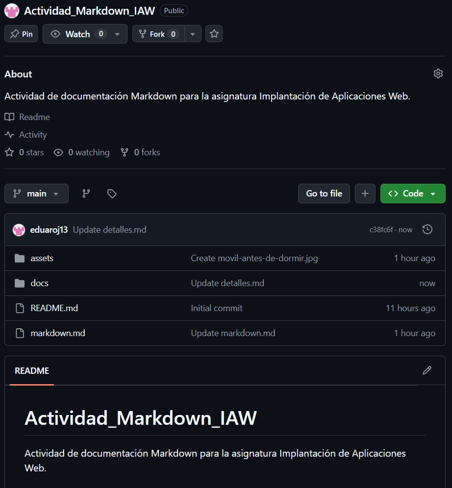

# Actividad: Desarrollo de Markdown

```#Información
Asignatura: Implementación de Aplicaciones Web
Nombre: Eduardo Rojas Aliaga
Fecha: 30 - 10 - 2026
Tema del proyecto: El sueño en los jóvenes
```

## 1. Objetivo del ejercicio

Aprender a estructurar documentación utilizando la sintaxis Markdown, conocer sus principales elementos y comprender cómo organizar archivos y carpetas dentro de un repositorio.

Además, se pretende aprender a utilizar rutas relativas para insertar imágenes locales y enlazar documentos, así como incorporar enlaces externos e imágenes procedentes de Wikimedia Commons.

## 2. Estructura del repositorio

El proyecto está organizado en diferentes archivos y carpetas para facilitar su organización y mantenimiento.

```#estructura
Actividad-Markdown-IAW
├── README.md
├── markdown.md
├── docs/
│   └── detalles.md
└── assets/
    ├── sueno.jpg
    ├── movil-antes-de-dormir.jpg
    └── consejos-mejorar-descanso.jpg
```

- `README.md`: documento de presentación del repositorio.
- `markdown.md`: documento principal sobre el sueño en los jóvenes.
- `docs/detalles.md`: documento secundario con información sobre el desarrollo de la actividad.
- `assets/`: carpeta que contiene las imágenes utilizadas en el proyecto.

## 3. Contenido del documento principal

El archivo `markdown.md` desarrolla el tema del sueño en los jóvenes y sus efectos sobre la salud y el rendimiento académico.

Para elaborar el documento se han utilizado los siguientes elementos de Markdown:

- **Títulos y subtítulos:** organización del contenido mediante encabezados.
- **Formato de texto:** utilización de negrita, cursiva y código en línea.
- **Bloques de código:** incorporación de un ejemplo escrito en Python.
- **Listas:** utilización de listas ordenadas y desordenadas.
- **Enlaces:** incorporación de enlaces externos y rutas relativas.
- **Imágenes locales:** utilización de imágenes almacenadas en la carpeta `assets`.
- **Imagen externa:** incorporación de una imagen del IES Clara del Rey procedente de Wikimedia Commons.
- **Tablas:** presentación de información sobre las horas de sueño recomendadas y una rutina nocturna.

## 4. Forma de entrega

Para completar la actividad, se debe disponer de un repositorio público de GitHub que contenga todos los archivos necesarios.

La entrega se realizará mediante:

- El enlace directo al repositorio público a través del aula virtual.
- Una captura de pantalla donde se pueda visualizar el repositorio desde GitHub.

