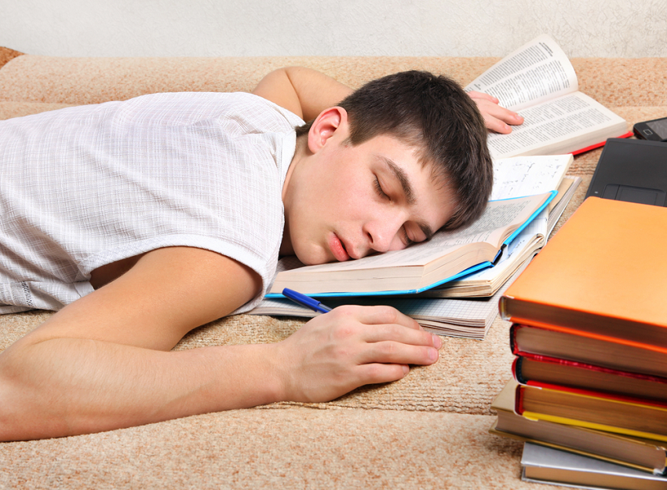

# El sueño en los jóvenes: un problema que afecta a la salud y al rendimiento



## Índice

* [Introducción](#1-introducción)

* [¿Por qué es importante dormir?](#2-por-qué-es-importante-dormir)

* [El sueño en la actualidad](#3-el-sueño-en-la-actualidad)

* [Principales causas](#4-principales-causas)

* [Consecuencias de dormir poco](#5-consecuencias-de-dormir-poco)

    * [Conceptos relacionados con el descanso](#conceptos-relacionados-con-el-descanso)

* [¿Cómo podemos mejorar el descanso?](#6-cómo-podemos-mejorar-el-descanso)

* [Horarios y necesidades de sueño](#7-horarios-y-necesidades-de-sueño)

    * [Tabla de horas de sueño recomendadas según la edad](#tabla-de-horas-de-sueño-recomendadas-según-la-edad)

* [Ejemplo de rutina nocturna](#8-ejemplo-de-rutina-nocturna)

    * [Representación de una rutina mediante código](#representación-de-una-rutina-mediante-código)

* [Conclusión](#9-conclusión)

* [Referencias](#10-referencias)

* [Información adicional](#11-información-adicional)

---

## 1. Introducción

El sueño es una necesidad biológica fundamental para el correcto funcionamiento del organismo. Durante el descanso, el cuerpo realiza procesos de recuperación y el cerebro organiza la información adquirida durante el día.

Sin embargo, dormir las horas necesarias se ha convertido en una dificultad para muchos jóvenes. Los estudios, el uso de dispositivos electrónicos, los horarios irregulares y las actividades sociales pueden reducir el tiempo dedicado al descanso.

La falta de sueño no solo provoca cansancio, sino que también puede afectar a la concentración, la memoria, el estado de ánimo y el rendimiento académico. Por este motivo, es importante comprender que descansar adecuadamente no es una pérdida de tiempo, sino una parte esencial de una vida saludable.

En este documento analizaremos las causas y consecuencias de dormir poco, así como algunas medidas para mejorar los hábitos de descanso. También veremos cómo influyen los horarios y qué rutinas pueden ayudar a conseguir un sueño de mayor calidad.

*Dormir bien es tan importante como mantener una alimentación equilibrada y realizar actividad física.*

---

## 2. ¿Por qué es importante dormir?

Dormir adecuadamente es esencial para mantener una buena salud física y mental. Durante las horas de sueño, el organismo desarrolla diferentes funciones que permiten recuperarse del esfuerzo diario y prepararse para el día siguiente.

Entre los principales beneficios del descanso encontramos:

- **Recuperación física:** ayuda al organismo a reparar tejidos y recuperar energía.

- **Memoria y aprendizaje:** favorece la consolidación de la información adquirida durante el día.

- **Concentración:** permite mantener la atención y realizar tareas con mayor eficacia.

- **Regulación emocional:** contribuye a controlar las emociones y mantener un estado de ánimo estable.

- **Sistema inmunitario:** participa en el correcto funcionamiento de las defensas del organismo.

Por tanto, dormir no consiste únicamente en descansar. Es un proceso necesario para que el cuerpo y el cerebro puedan funcionar correctamente.

---

## 3. El sueño en la actualidad

En la actualidad, los hábitos de descanso de los jóvenes están condicionados por diferentes aspectos de su vida cotidiana. Las responsabilidades académicas, las actividades extraescolares y el uso frecuente de dispositivos electrónicos pueden dificultar que mantengan horarios regulares.

Uno de los factores más destacados es el uso de teléfonos móviles, ordenadores y tabletas durante las últimas horas del día. Muchas personas utilizan estos dispositivos antes de acostarse para consultar redes sociales, ver vídeos, jugar o comunicarse con otras personas.

Además, los contenidos digitales están disponibles a cualquier hora, lo que puede favorecer que los jóvenes retrasen el momento de irse a dormir. Esta situación puede provocar que duerman menos horas de las necesarias, especialmente cuando deben levantarse temprano para acudir al centro educativo.

Por este motivo, mantener un equilibrio entre las actividades diarias y el descanso se ha convertido en un aspecto importante para cuidar la salud y el rendimiento académico.

---

## 4. Principales causas

La falta de sueño entre los jóvenes puede deberse a diferentes factores relacionados con sus hábitos diarios, su entorno y sus responsabilidades. Entre las causas más habituales destacan las siguientes:

- **Uso excesivo de dispositivos electrónicos:** pasar mucho tiempo con el móvil, el ordenador o la televisión, especialmente antes de acostarse.
- **Responsabilidades académicas:** dedicar muchas horas al estudio, realizar trabajos o preparar exámenes puede reducir el tiempo disponible para dormir.
- **Horarios irregulares:** acostarse y levantarse a horas diferentes dificulta mantener una rutina de descanso estable.
- **Actividades sociales:** salir con amigos, jugar a videojuegos o utilizar redes sociales hasta altas horas de la noche puede retrasar la hora de dormir.
- **Consumo de estimulantes:** tomar bebidas con cafeína o energéticas durante las últimas horas del día puede dificultar la conciliación del sueño.

En muchos casos, estos factores se combinan entre sí. Por ejemplo, un estudiante puede terminar sus tareas tarde, utilizar el móvil antes de acostarse y tener que levantarse temprano para acudir a clase.

---

## 5. Consecuencias de dormir poco

Dormir menos horas de las necesarias puede tener consecuencias negativas tanto a corto como a largo plazo. La falta de descanso afecta al funcionamiento del cerebro y del organismo, dificultando la realización de actividades cotidianas.

Entre las principales consecuencias encontramos:

1. **Disminución del rendimiento académico:** puede dificultar la concentración, la memoria y el aprendizaje.
2. **Cansancio durante el día:** provoca sensación de agotamiento y menor energía para realizar actividades.
3. **Cambios en el estado de ánimo:** puede aumentar la irritabilidad y dificultar la regulación emocional.
4. **Menor capacidad de atención:** puede incrementar los errores al realizar tareas que requieren concentración.
5. **Alteraciones en la salud:** mantener una falta de sueño prolongada puede afectar negativamente al bienestar físico y mental.

Es importante tener en cuenta que las consecuencias pueden variar según la edad, las horas de descanso y la frecuencia con la que se duerme menos de lo necesario.

### Conceptos relacionados con el descanso

- **Higiene del sueño:** Conjunto de hábitos y condiciones ambientales que favorecen un descanso adecuado.

- **Insomnio:** Dificultad persistente para conciliar el sueño, mantenerlo o conseguir un descanso reparador.

- **Ritmo circadiano:** Sistema biológico que regula los ciclos de sueño y vigilia aproximadamente cada 24 horas.

Para ampliar esta información, se puede consultar la [guía sobre el sueño de los Centros para el Control y la Prevención de Enfermedades (CDC)](https://www.cdc.gov/sleep/).

---

## 6. ¿Cómo podemos mejorar el descanso?

Para conseguir un descanso adecuado, es importante mantener unos hábitos saludables y establecer una rutina que permita al organismo prepararse para dormir.

Algunas recomendaciones que pueden ayudar son:

1. Mantener un horario regular para acostarse y levantarse.
2. Evitar el uso de teléfonos móviles y ordenadores justo antes de dormir.
3. Mantener la habitación oscura, silenciosa y a una temperatura agradable.
4. Evitar las bebidas con cafeína durante las últimas horas del día.
5. Realizar actividad física de forma habitual, evitando el ejercicio intenso justo antes de acostarse.
6. Evitar las comidas demasiado abundantes antes de dormir.

---

## 7. Horarios y necesidades de sueño

Las necesidades de sueño varían según la edad de cada persona. Durante la adolescencia, el descanso adquiere una especial importancia debido a los cambios físicos, hormonales y cognitivos que se producen durante esta etapa.

No todas las personas necesitan exactamente las mismas horas de sueño, pero existen recomendaciones generales que permiten establecer unos hábitos adecuados.

### Tabla de horas de sueño recomendadas según la edad

| Grupo de edad | Horas recomendadas | Importancia del descanso |
|---------------------------|--------------|--------------------|
| Adolescentes (13-17 años) | 8-10 horas | Favorece el desarrollo y el aprendizaje. |
| Adultos jóvenes (18-25 años) | 7-9 horas | Contribuye al rendimiento físico y mental. |
| Adultos (26-64 años) | 7-9 horas | Ayuda a mantener una buena salud general. |
| Adultos mayores (65 años o más) | 7-8 horas | Favorece el bienestar y la recuperación. |

Estos valores son recomendaciones generales y pueden variar según las necesidades individuales.

Establecer una hora fija para acostarse y levantarse permite mantener una rutina más regular y facilita la organización de las actividades diarias.

---

## 8. Ejemplo de rutina nocturna

Establecer una rutina antes de dormir puede ayudar a preparar el organismo para el descanso. Lo recomendable es reducir progresivamente las actividades estimulantes y mantener unos horarios regulares.

A continuación, se muestra un ejemplo sencillo de planificación de las actividades previas al sueño:

| Hora | Actividad |
|---|---|
| 21:30 | Finalizar las tareas académicas. |
| 22:00 | Preparar la ropa y organizar el día siguiente. |
| 22:15 | Dejar de utilizar dispositivos electrónicos. |
| 22:30 | Realizar una actividad relajante. |
| 23:00 | Acostarse y descansar. |

### Representación de una rutina mediante código

```python
rutina_nocturna = {
    "21:30": "Finalizar las tareas académicas",
    "22:00": "Preparar la ropa y organizar el día siguiente",
    "22:15": "Dejar de utilizar dispositivos electrónicos",
    "22:30": "Leer o realizar una actividad relajante",
    "23:00": "Acostarse y descansar"
}

print("Rutina nocturna:")

for hora, actividad in rutina_nocturna.items():
    print(hora, "-", actividad)